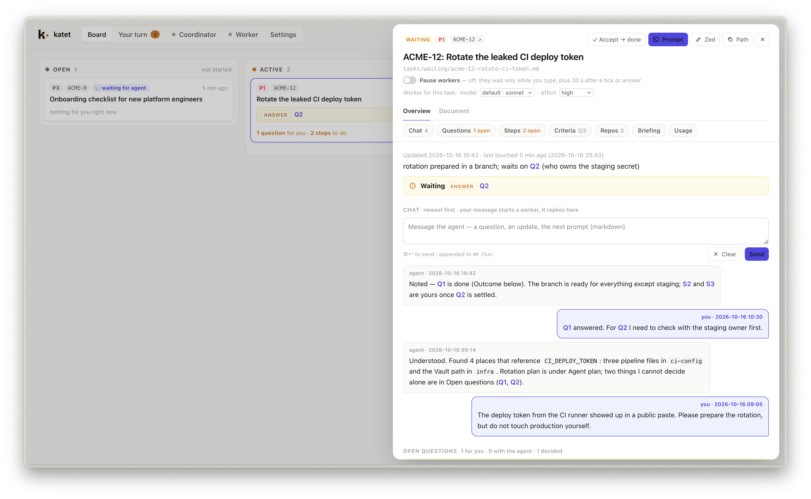

> We are ka-tet. We are one from many. 

Roland Deschain, of Gilead. (The Dark Tower by Stephen King)

<picture>
  <source media="(prefers-color-scheme: dark)" srcset="assets/brand/katet-wordmark-dark.svg">
  
</picture>



A markdown-file workflow for working with coding agents. katet runs **agentfiles**: one markdown
file per task with a fixed structure (briefing, chat, questions with answers and outcomes, numbered
next steps, acceptance criteria), whose folder is its state. The format belongs to no tool; katet is
what watches, dispatches and shows it.

A coordinator watches the files and, whenever you edit one (answer a question, send a chat message,
tick a step), starts a headless run of a coding agent on it under a strict tool allow-list, one at
a time, with loop guards. The agent reads its instructions from the task file; Claude Code is built
in, and other agents attach as small adapters (`board/agents.py`). A local web board and a small macOS menu-bar app show the tasks, let you
answer and chat without an editor, and notify you when an agent needs you.


## Install

```bash
git clone https://github.com/la3mmchen/katet ~/src/katet
export PATH="$HOME/src/katet/bin:$PATH"     # in your shell profile
brew install fswatch                             # the coordinator watches files with it
```

Needs Python 3.9+, git, the CLI of the agent you configure (Claude Code by default), and for
the app macOS with the Xcode Command Line Tools (`swiftc`). Tested with Claude Code 2.1.287 on
macOS 26.

## A workspace

Your tasks live in a **workspace**, a folder (usually its own git repo) that the framework never
writes code into:

```bash
katet init ~/work            # tasks/, CLAUDE.md, katet.conf, coordinator.tools
cd ~/work
katet board                  # http://127.0.0.1:8765
katet coordinator            # in a second terminal; --dry only reports
katet app build              # ~/Applications/katet.app; opens any workspace
```

- `CLAUDE.md` imports the framework's rules (`KATET.md`) and holds what is yours: where repos
  live, your ticket system, commit habits.
- `katet.conf` sets the port, the editor button (Zed, VS Code, Cursor) and a ticket URL pattern.
- The workspace is a git repo you commit yourself; katet never commits.
- `coordinator.tools` is the allow/deny list and the limits for workers (model, effort, budget per
  run). Anything not allowed is refused; the workspace's own setup files and every `.git/` are always
  denied. A task can pin its own model, effort or budget in its Briefing.

The framework finds the workspace from `--workspace DIR`, `$KATET_WORKSPACE`, or by walking
up from the current directory to the first `katet.conf`.

## See it

`examples/demo-workspace/` holds three fictional tasks. Open that folder in the app, or run `katet board`
inside it, to see the board with questions, steps, a commit hand-over and a task waiting for acceptance.

## How a task flows

1. Create a task on the board (**New task**) or copy the framework's `task.template.md` into `tasks/open/`.
2. The agent fills the briefing, asks in **Open questions**, lists **Next steps** for you, and moves
   the file to `waiting — answer: Q1` or `waiting — action: …`.
3. You answer on the board. The coordinator starts a worker, which writes the **Outcome**, does the
   work, and moves the task on. Finished work goes to `waiting — action: accept …`; only you move a
   task to `done`, with one click on the board.

The rules the agents follow are in `KATET.md`; the format of a task is `task.template.md` (both in the framework; a workspace may carry its own copy of the template).

## Status

One author's working setup, hardened over a few weeks of daily use. Take what fits.
